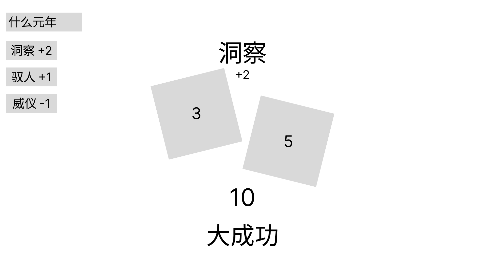

# S_骰子判定与能力系统_系统规则

## 文档基本信息

| 项目 | 内容 |
|---|---|
| 项目名称 | Herstory（暂定） |
| 系统名称 | 骰子判定与君主能力系统 |
| 文档类型 | 系统规则 / 数值设计 |
| 文档版本 | V2.4 |
| 创建日期 | 2026.8.31 |
| 作者/负责人 | MDR |
| 适用范围 | Godot Demo 骰子判定与君主能力模块 + 正式版设计基线 |

## 更新记录

| 日期 | 版本 | 更新内容 | 作者 |
|---|---|---|---|
| 2026.8.26 | V1.0 | 骰子与能力系统初稿（七项能力、四档结果） | MDR |
| 2026.8.27 | V1.0 | 骰子判定系统规则初稿（2d6、修正来源） | MDR |
| 2026.8.31 | V2.0 | 整合骰子判定与能力规则，对齐主策划案 V1.2：三档结果、三项能力、State 不进公式、固定阈值+方案影响阈值要求；能力 ID 锚定工程为 insight/influence/majesty；阈值向玩家公开；附投骰界面原型 | MDR |
| 2026.9.2 | V2.1 | 三档分界改 6/9（失败<6、有条件 6-8、完全≥9）；方案难度由两档激进/稳妥改为五档静态难度（difficulty，-2~+2，越大越难），只平移成功阈值（完全成功门槛=9+difficulty、失败门槛=6+difficulty）；明确难度为事件静态属性，成长曲线靠事件库按阶段分难度池投放 | MDR |
| 2026.9.3 | V2.2 | difficulty 由方案级改为**事件级必填**（对齐主策划案 V1.3 6.5 统一口径）：一属性两用（判定阈值 + 投放顺序/解锁先后）；日常 -2~0、危机统一 +1、重大 +2；"成长曲线靠分难度池投放"表述改为"按难度档解锁进统一池"（主策划案 6.4/6.5）；7.2 字段表删除方案级 difficulty | MDR |
| 2026.9.10 | V2.3 | 能力等级上下限由 0–3 放宽为 **−1 ~ +10**（下限 −1 允许负项腾点数、上限 10；工程 CharacterBuildPage.gd MIN_VALUE = -1 / MAX_VALUE = 10）；**建卡初始发放点数不变，仍为 2 点**（BUDGET = 2），上限 10 靠后续成长累积；建卡与成长页**减号均可用**（成长页可在本项原值~原值+1 之间自由反复调整，支持撤销改选）；判定值越界规则不变（允许低于 2 或高于 12，按阈值正常判定） | MDR |
| 2026.9.10 | V2.4 | 难度档由**五档 −2~+2 扩为七档 −3~+3**：日常 −3~+1（−3×4 / −2×6 / −1×13 / 0×16 / +1×8）、危机 +1~+2（+1×11 / +2×5）、重大 +3；3.3 难度表重算为七档概率表（每 ±1 档平移一格，−3/+3 仍各留 1/36，不触底）；难度第二角色由"投放顺序/分档解锁"改为**阶段权重倾斜**（全池常驻，一期偏简单、二期均匀、三期偏难，见主策划案 6.4/6.5）；1.4 名词定义、3.2 修正来源说明、7.2 字段说明同步 | MDR |

---

## 一、系统概述

### 1. 功能定位

骰子判定是微观循环「方案 + 能力 → 投骰 → 行动结果」的结算环节。它把玩家可理解的输入（选择的方案、君主能力、当前国家状态）转化为三档结果，并驱动 State 变化与史官反馈。

骰子只解决行动结果，不承担移动或其他功能。

### 2. 设计目标

骰子系统回答的不是"国家够不够强"，而是"这位君主能否以自己的方式处理眼前的政治问题"：

- 君主能力决定处理方式的成功概率（洞察 / 驭人 / 威仪）。
- 国家 State 只构成行动条件、风险与结果后果，不直接加骰子。
- 该分工避免两类数值打架：国力充足也可能手段失败；国力有限，有能力的君主也能争取关键成果。

### 3. 用户体验目标

- 玩家在投骰前能预估成功率，但不确知结果。
- 每项修正来源（能力、大臣）在界面上可见、可解释。
- 失败也应有逻辑（与局势、人选有关），而非纯粹随机惩罚。

### 4. 名词定义

| 名词 | 定义 |
|---|---|
| 骰值 | 2d6 两个骰面点数之和，范围 2–12 |
| 修正 | 加在骰值上的整数加值或减值，目前仅来自主能力等级 |
| 判定值 | 骰值 + 所有修正，允许低于 2 或高于 12 |
| 结果档位 | 完全成功 / 有条件成功 / 失败 三档 |
| 主能力 | 方案进行判定时唯一使用的君主能力 |
| 事件难度 | 事件级静态难度档（difficulty，-3~+3 共七档，越大越难）。一属性两用：①判定阈值（不修正骰值，只平移本事件成功阈值）②阶段权重倾斜（早期偏简单、后期偏难，见主策划案 6.5）。日常 -3~+1、危机 +1~+2、重大 +3 |

---

## 二、君主能力

### 1. 能力分类（三项）

| 能力 ID | 名称 | 定义 | 典型用途 |
|---|---|---|---|
| insight | 洞察 | 看清人物、情报、动机与风险 | 查案、识破阴谋、判断局势、发现危机 |
| influence | 驭人 | 改变人物与派系的行为 | 谈判、安抚、利诱、离间、制衡、外交 |
| majesty | 威仪 | 让君主身份转化为实际服从 | 宣令、震慑、册封、强制、武力镇压、公开权威 |

英文 ID 锚定现有工程 `data/events.json`（insight、majesty 已使用，influence 待事件补齐驭人方案时启用）。

### 2. 能力等级与初始分配

能力等级取 −1 ~ +10（下限 −1、上限 +10），作为判定修正（见第三章）。

**上下限与初始点数是两件事**：上限 10 是能力值本身的天花板；建卡时初始只发放 **2 点**，剩余幅度靠后续成长（危机后能力成长等）累积至上限 10。建卡分配**允许负项**——某一项可以扣到 −1 以腾出点数给其他项（例：洞察 −1 / 驭人 +2 / 威仪 +1，三项合计仍为 2 点），因此单项最高可到 3（用 −1 换 1 点）。工程锚点：`CharacterBuildPage.gd` 的 `MIN_VALUE = -1` / `MAX_VALUE = 10` / `BUDGET = 2`。

能力修正由君主建卡提供，不配置在事件数据中。是否在 UI 常驻展示待确认；推荐在君主档案内完整展示，方案选中后突出本次主能力与其修正。

### 3. 能力与国家 State 的分工

- 帝王能力决定君主处理方式的成功概率。
- 国家 State 决定方案是否可用、需要多少资源、后果有多严重。
- 帝王能力不等于国家实力；国家数值不直接加骰子结果。
- 例：军队足够高可解锁"武力镇压"，但镇压是否形成稳定秩序，仍由威仪判定决定。

---

## 三、判定规则

### 1. 基础公式

```
正式版：最终判定值 = 2d6 + 主能力等级 + 大臣修正（未实现）
Demo  ：最终判定值 = 2d6 + 主能力等级
```

### 2. 修正来源

| 来源 | 取值范围 | 说明 | 数据来源 |
|---|---|---|---|
| 主能力等级 | −1 ~ +10 | 方案唯一主能力对应的君主能力等级 | 君主建卡 |
| 大臣修正 | 0 ~ +2 | 未实现，正式版加入 | ministers.json |

事件难度与 State（可见或隐藏）均不修正骰值。事件难度只平移本事件的成功阈值要求（见 3.3），并决定其在当前阶段的抽取权重系数（见主策划案 6.5）。

### 3. 结果档位与阈值

三档分界统一采用「值列表三段式」约定：`失败值 | 有条件成功值 | 完全成功值`。

标准档（difficulty = 0）为 6/9 分界 `2,3,4,5 | 6,7,8 | 9,10,11,12`：

| 判定值 | 档位 | 无修正时概率 |
|---|---|---|
| < 6（2,3,4,5） | 失败 | 10/36 ≈ 27.8% |
| 6 – 8（6,7,8） | 有条件成功 | 16/36 ≈ 44.4% |
| ≥ 9（9,10,11,12） | 完全成功 | 10/36 ≈ 27.8% |

> 6/9 分界使失败与完全成功概率严格相等（各 27.8%），三档整体沿 7 镜像对称。

事件难度是**事件级静态属性**（写死进 events.json，运行时不变），一属性两用：

- **判定阈值**：不修正骰值，只**平移**本事件的成功阈值，难度越大越难：完全成功门槛 = 9 + difficulty，失败门槛 = 6 + difficulty；两门槛之间恒为 3 格（有条件成功值）。
- **阶段权重倾斜**：难度档决定该事件在当前阶段的抽取权重系数，早期多出简单事件、后期多出难事件（规则见主策划案 6.4 / 6.5）。

难度值在 events.json 的事件级 `difficulty` 字段配置；特殊事件还可整体覆盖阈值。**日常事件难度取 -3~+1，危机取 +1~+2，重大统一 +3。**

七档难度：

| 难度档位 | difficulty | 值列表三段式 | 失败 | 有条件成功 | 完全成功 |
|---|---|---|---|---|---|
| 极易 | −3 | `2 \| 3,4,5 \| 6,7,8,9,10,11,12` | 2.8% | 25.0% | 72.2% |
| 很易 | −2 | `2,3 \| 4,5,6 \| 7,8,9,10,11,12` | 8.3% | 33.3% | 58.3% |
| 易 | −1 | `2,3,4 \| 5,6,7 \| 8,9,10,11,12` | 16.7% | 41.7% | 41.7% |
| 标准 | 0 | `2,3,4,5 \| 6,7,8 \| 9,10,11,12` | 27.8% | 44.4% | 27.8% |
| 难 | +1 | `2,3,4,5,6 \| 7,8,9 \| 10,11,12` | 41.7% | 41.7% | 16.7% |
| 很难 | +2 | `2,3,4,5,6,7 \| 8,9,10 \| 11,12` | 58.3% | 33.3% | 8.3% |
| 极难 | +3 | `2,3,4,5,6,7,8 \| 9,10,11 \| 12` | 72.2% | 25.0% | 2.8% |

> 七档沿标准档镜像对称（极易 ↔ 极难、很易 ↔ 很难、易 ↔ 难），每 ±1 档仅将三档概率块整体平移一格。−3 与 +3 已接近 2d6 量程边缘（失败只剩"2"一种、完全成功只剩"12"一种，各 1/36 ≈ 2.8%）但并未触底，因此难度范围无需再压缩。

**设计原则：难度是事件级静态属性，不随玩家实时缩放。** 能力修正的意义正源于"难度不追着能力走"——同一件事，+2 洞察比 +0 洞察更常成功。

**难度曲线靠"阶段权重倾斜"实现，不靠分档解锁**：全部日常事件从第 1 轮起就在统一池内、永久可出，三阶段只改变各难度档的抽取权重系数（一期偏好简单、二期均匀、三期偏好难）。不按难度拆池——拆了每组只剩十几条，玩几轮就开始重复。危机与重大不参与权重倾斜：后期真正的压力增量由它们（+1/+2 与 +3）承担，出现与否取决于触发条件与里程碑，而非权重。权重表见主策划案 6.5。

**本方案有效成功阈值向玩家公开**（执行前明示）。界面显示修正明细、档位标签与本方案阈值，不显示概率百分比。

### 4. 边界与异常情况

- 修正后判定值允许越界（低于 2 或高于 12），按阈值正常判定。
- 同一事件同一方案不允许重复投骰；投骰确认后不可撤回。
- 随机数必须使用可配置种子的 RandomNumberGenerator，测试模式固定种子以保证可复现。
- 方案可用性与风险提示在投骰前明示，不作为隐藏惩罚。
- 事件覆盖阈值只影响该事件自身，不改变全局默认。

### 5. 投骰界面原型



> 原型图来自 `UI_0827/骰子.png`。UI 同时列出三项能力修正供信息透明，实际判定仅使用本方案的主能力。图中"大成功"对应文档档位"完全成功"。

---

## 四、结果结算

| 档位 | 定义 | State 效果 | 史官反馈要求 |
|---|---|---|---|
| 完全成功 | 按方案预期的最佳方式解决问题，主要风险被控制 | 应用方案正向效果全额 | 叙述目标达成，肯定决策 |
| 有条件成功 | 方案有效，但必须接受事件预设的条件 | 正向效果打折或附加一项明确条件/代价 | 明确说明"得到了什么、付出了什么"，条件必须可追踪 |
| 失败 | 未解决核心问题 | 无正向效果，可能附加负面变化（视方案而定） | 解释失败与局势/人选的因果，避免纯随机挫败感 |

- "有条件成功"不拆分为"部分成功"与"成功但付出代价"；具体条件由事件配置，必须明确、可追踪（落到 State Change、隐藏 State 变化、事件标记等），并在史官反馈中说明。
- 每个事件方案的三档各自配置 State 效果与史官文本，数据驱动，不在此处硬编码。
- 判定结果按事件配置改变可见 State 与隐藏 State 的数值（见第五章）。

---

## 五、隐藏 State

### 1. 定位

隐藏 State 默认不显示精确数值，只透过事件、人物、大臣可用性和史官记录给出方向性反馈（定性区间，如 0–29 民怨沸腾）。

### 2. 隐藏 State 清单（起步，对齐主策划案 5.2）

| 隐藏 State | 含义 | 反馈方式 |
|---|---|---|
| 贵族支持度 | 贵族阶层对君主及政策的支持程度 | 人物态度、方案可用性、史官记录 |
| 平民支持度 | 普通民众对君主及政策的支持程度 | 民生事件、公共反应、史官记录 |
| 统治合法性 | 社会是否认可君主统治 | 威仪方案、重大事件与终局评价 |
| 中枢掌控 | 君主对宫廷和决策中枢的实际控制力 | 人事、权力与事件分支 |
| 历史条件 | 长期选择形成的结构性条件 | 重大事件触发与终局史评 |

### 3. 与判定的关系

目前隐藏 State 对骰子结果没有影响：不提供修正、不参与判定。

判定的成功/失败结果会按事件配置改变隐藏 State 的数值（如支持度变化），并通过史官文本与定性区间反馈给玩家。

---

## 六、当前未实现

目前仅以下一项未实现：

- **大臣修正（0 ~ +2）**：正式版加入，Demo 不实现。标签匹配、能力类型等具体规则待大臣系统设计时补充。

---

## 七、数据配置

### 1. 阈值表 `thresholds`

| min_total | max_total | tier | 默认 |
|---|---|---|---|
| -99 | 5 | fail | ✓ |
| 6 | 8 | partial | ✓ |
| 9 | 99 | full | ✓ |

事件可覆盖：`cfg_event_option` 支持可选覆盖阈值；未覆盖时使用全局默认。

### 2. 事件字段（events.json 内嵌）

事件级字段含 `difficulty`（事件难度档，必填，取值 -3~+3 七档，见 3.3 与主策划案 6.5）；方案级字段如下：

| 字段 | 类型 | 说明 |
|---|---|---|
| id | string | 方案唯一编号 |
| name | string | 方案名（直白动词短语，显示给玩家） |
| direction | string | 方向：得到什么、牺牲什么 |
| ability | enum | 本方案唯一主能力：insight / influence / majesty |
| thresholds | object | 可选，事件级覆盖全局阈值 |
| effects | object | 三档各自的 State 变化 |
| chronicle | object | 三档各自的史官文本 |

注：能力修正不配置在事件数据中（由君主建卡提供），原 `ability_modifier` 字段废弃。